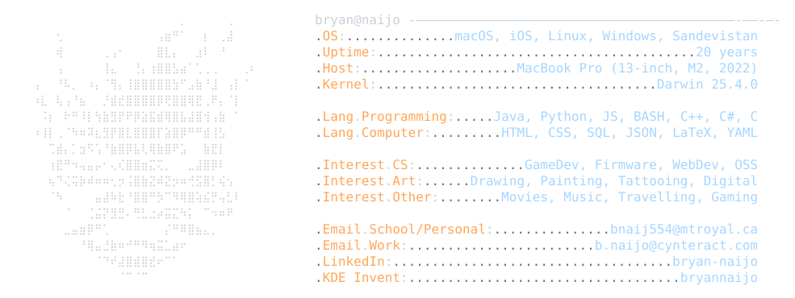

  

\
\
I plan to also use this as a temporary area to list what I am doing/plan to, atleast until I get my own personal site or blog going.

- [ ] Personal website
  - Neocities? indie web in general
- [ ] Krita contributions
  - SmartZoom functionality
  - Touchpad panning bug
- [ ] Breach Protocol TUI game
  - part of larger Cyberpunk 2077 ricing?
- [x] Track dotfiles (to start ricing again)
  - Nix sys flake as well
- [ ] Finish drone project
  - rewrite with RTOS implementation
- [ ] Apple BLE implementation for Cynteract's new firmware
- [ ] Emacs workflow?
  - DOOM
  - org mode
- [ ] flesh out contents in README
- light mode SVG
- GitHub action to autogenerate date
